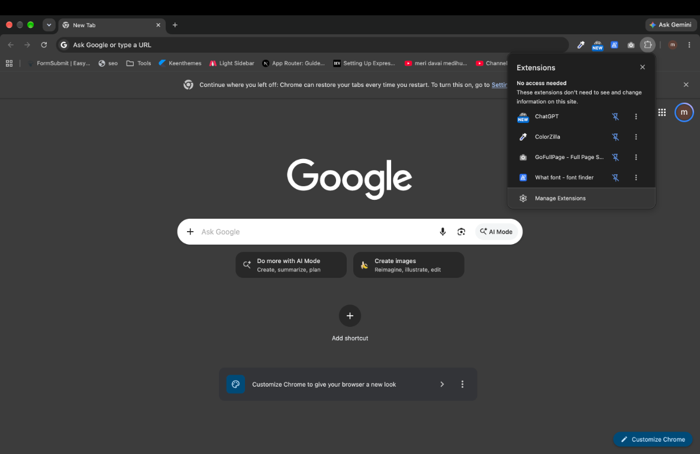
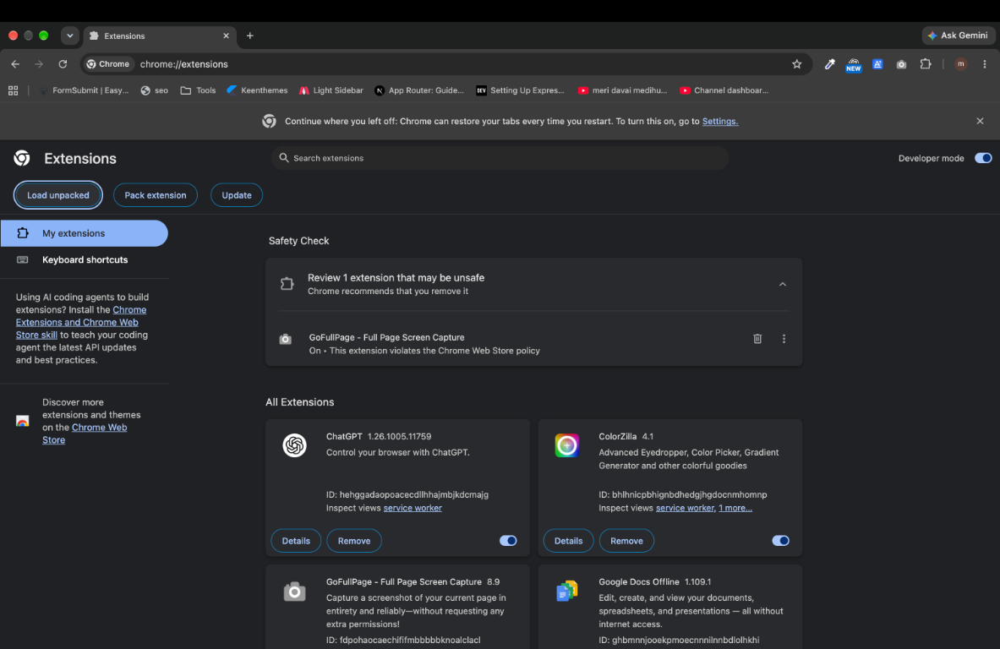
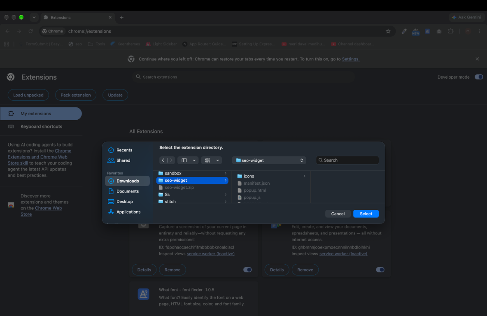
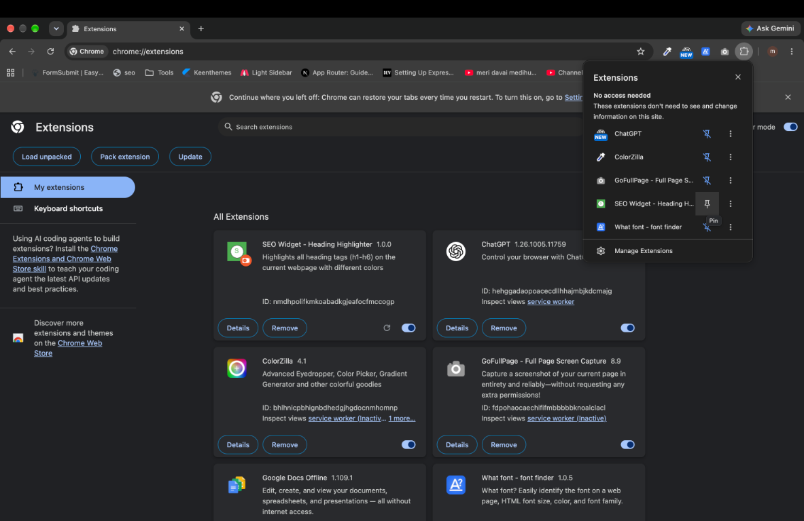

# SEO Widget - Chrome Extension

A Chrome extension that highlights all heading tags (h1-h6) on any webpage with different colors when activated.

## Features

- Highlights all heading tags (h1-h6) on the current webpage
- Each heading level gets a different background color:
  - H1: Pink
  - H2: Orange
  - H3: Yellow
  - H4: Aquamarine
  - H5: Light Sky Blue
  - H6: Plum
- Adds borders and padding to headings for better visibility
- Prepends heading level (H1-, H2-, etc.) to the heading text

## Installation

1. **Download or clone this repository**
   ```bash
   git clone <repository-url>
   cd seo-widget
   ```

2. **Open Chrome's Extensions page**
   - Open Chrome and go to `chrome://extensions/`, or click the three dots menu → **Extensions** → **Manage Extensions**.
   - The **Manage Extensions** option is also available from the Extensions (puzzle piece) menu.

   

3. **Enable Developer Mode**
   - Toggle the "Developer mode" switch in the top right corner

4. **Load the extension**
   - Click **Load unpacked**.

   

5. **Select the extension folder**
   - Select the `seo-widget` folder (the folder containing `manifest.json`), then click **Select**.
   - The extension should now appear in your extensions list

   

6. **Pin the extension (optional)**
   - Click the puzzle piece icon in Chrome's toolbar.
   - Find **SEO Widget - Heading Highlighter** and click the pin icon to keep it visible in the toolbar.

   

## Usage

1. Navigate to any webpage where you want to highlight headings
2. Click the SEO Widget extension icon in your Chrome toolbar
3. Click the "Highlight Headings" button in the popup
4. All headings on the page will be highlighted with their respective colors

## Files Structure

```
seo-widget/
├── manifest.json          # Extension configuration
├── popup.html            # Extension popup UI
├── popup.js              # Popup logic and script injection
├── icons/                # Extension icons
│   ├── icon16.png
│   ├── icon48.png
│   └── icon128.png
├── docs/                  # Installation screenshots
└── README.md              # This file
```

## How It Works

The extension uses Chrome's Manifest V3 API to inject a script into the current webpage. When you click the "Highlight Headings" button:

1. The popup script (`popup.js`) gets the current active tab
2. It injects the `highlightHeadings()` function into the page using `chrome.scripting.executeScript`
3. The function finds all h1-h6 elements and applies styling:
   - Background colors based on heading level
   - Solid borders
   - Padding for better visibility
   - Prepends heading level to the text

## Customization

You can modify the colors in `popup.js` by changing the `f` array:
```javascript
f = new Array('pink', 'orange', 'yellow', 'aquamarine', 'lightskyblue', 'plum');
```

## Requirements

- Google Chrome browser (version 88 or higher for Manifest V3 support)
- No additional dependencies required for the extension itself

## Troubleshooting

- **Extension not loading**: Make sure Developer Mode is enabled
- **Script not running**: Some pages (like `chrome://` pages) cannot have scripts injected for security reasons
- **Icons not showing**: Make sure the `icons` folder contains all three icon files (icon16.png, icon48.png, icon128.png)

## License

This project is provided as-is for educational and personal use.
